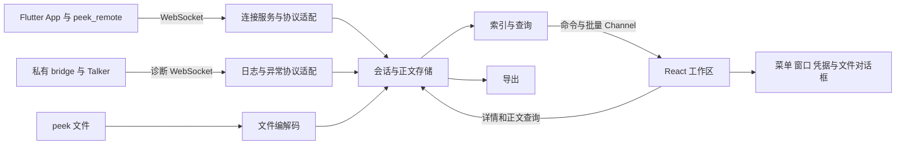

# Peek Desktop 技术与界面方案

日期：2026 年 11 月 13 日，北京时间  
阶段：P1 连接闭环已接入；当前验收范围见 [P1 实施记录](P1实施记录.md)

Peek Desktop 使用 Tauri 2 开发 Windows 和 macOS 桌面网络检查器，接收 Flutter App 中 `peek_remote` 已记录的数据，并通过自有诊断 SDK 增加普通日志与异常预览。两端共用 Rust 核心、前端界面和翻译资源，菜单、窗口与凭据存储通过平台接口适配。

默认技术组合为 **Tauri 2 + Rust + React 19 + TypeScript + Vite**。界面采用 **Tailwind CSS 4 + shadcn/ui** 定制为紧凑的桌面工具风格；请求列表采用 **TanStack Table + TanStack Virtual**；JSON 树采用 **vanilla-jsoneditor**，其他文本类型后续再评估 **CodeMirror 6**。离线工作区已接入 Tailwind、源码拥有的 Radix 基础控件、虚拟表格和 JSON 树；文本先使用有容量限制的只读原文。

普通日志与异常采用自有 Flutter 私有 package `peek_desktop_bridge`，保留标准 Peek 网络链路，增加独立诊断通道并协调同一次配对。详细契约、ePay 原始堆栈适配与桌面预览见 [普通日志与异常同步方案](普通日志与异常同步方案.md)。

## 1 四个问题的直接结论

| 问题 | 本项目的安排 |
| --- | --- |
| UI 能否参考 Peek Pro 与其他软件 | 以 Peek Pro 的会话、请求列表和详情结构为主要参考，结合 Proxyman 的桌面布局、Chrome DevTools 的详情分类、HTTP Toolkit 的正文查看交互；建立自己的组件和设计变量 |
| JSON 是否有成熟渲染方案 | 有。优先验证 vanilla-jsoneditor，按需使用 CodeMirror 6；Monaco 作为未来重放、编辑和对比功能的候选，不在首页同时加载多个编辑器 |
| 哪个前端框架响应更快 | React、Vue、Svelte、Solid 都可以实现本项目；当前选择 React 19 以延续现有 Tauri 项目的维护经验。实际速度由虚拟化、数据批处理、IPC、解析位置和正文加载策略共同决定，不能仅凭框架排名判断 |
| 采用什么界面风格 | 紧凑、克制的桌面开发工具风格：三栏可调整布局、深浅主题、低饱和中性色、清晰的状态色、中英文与完整键盘操作 |

## 2 产品范围

### 第一版提供的能力

1. Windows 与 macOS 共用一套应用，显示本机连接地址、端口、配对码和设备状态
2. 与现有 `peek_remote` 协议兼容，支持手动地址连接、设备配对、历史同步和断线重连
3. 显示会话、请求列表、搜索过滤、请求与响应详情、错误和耗时
4. 支持 JSON 树、原文、格式化文本、Headers、Query、Cookies、图片与二进制摘要
5. 打开和保存 `.peek` 文件，提供 cURL、HAR 和文本导出
6. 提供简体中文、英文和深浅主题，菜单文案与页面保持一致
7. 通过私有 SDK 预览普通日志、结构化属性和完整异常堆栈，提供日志、异常与关联时间线

应用接收 App 内已经采集的数据。HTTP 代理、证书安装、HTTPS 解密、流量修改和请求重放属于不同范围，第一版不展开。上游同样将 Peek Pro 定位为 Peek 数据查看器，协议与文件格式公开供其他查看器实现。[Peek Pro 项目说明](https://github.com/artdima/peek-pro)

### 当前工程状态

已在骨架上实现 `.peek` 原生打开/保存、Rust 有界会话与窗口查询、三栏虚拟表格、按需正文、无损 JSON、双语与主题。P1 已接入连接服务、系统凭据配对、私有日志 SDK 与日志/异常基础查看。完整菜单、时间线及以下性能目标仍属后续内容。实际验证以 [P0 实施进度](实施进度.md) 与 [P1 实施记录](P1实施记录.md) 为准。

项目暂名 `Peek Desktop`，目录为 `peek-desktop`，Bundle identifier 暂用 `local.peek.desktop`。对外发布前再确定正式名称、标识与应用图标。

## 3 界面参考与交互安排

| 参考产品 | 采用的设计方向 | 本项目中的落点 |
| --- | --- | --- |
| [Peek Pro](https://github.com/artdima/peek-pro) | 会话侧栏、请求表格、详情位于右侧或底部、配对入口 | 默认信息架构及与现有 App 的连接体验 |
| [Proxyman](https://proxyman.com/) | 紧凑工具栏、可调整分栏、清楚的请求与响应区分 | 窗口结构、密度、选择态与详情浏览 |
| [Chrome DevTools Network](https://developer.chrome.com/docs/devtools/network/) | 快速过滤、Headers、Payload、Preview、Response 与 Timing 的分类 | 搜索、过滤条件与详情标签组织 |
| [HTTP Toolkit](https://httptoolkit.com/) | 内容类型对应的正文查看方式与复制操作 | JSON、文本、图片、Hex 的切换及错误说明 |

参考重点是布局、信息层次和操作习惯。组件在本项目内实现；只有实际引入上游代码或素材时才保留对应来源与许可文件。

### 默认布局

```text
┌──────────────────────────────────────────────────────────────────────────┐
│ Peek Desktop   连接设备   打开文件   搜索               主题  设置       │
├──────────────┬─────────────────────────────┬───────────────────────────┤
│ 会话         │ 全部 / 错误 / 进行中 / 固定  │ GET /account              │
│              ├─────────────────────────────┤                           │
│ 在线设备     │ 方法 状态 地址 耗时 大小 时间│ 概览 请求 响应 耗时 错误  │
│ · App A      │                             ├───────────────────────────┤
│ · App B      │        请求虚拟表格         │ Headers / Body            │
│              │                             │ 树 / 原文 / 格式化        │
│ 已打开文件   │                             │                           │
│ · session    │                             │        正文查看器         │
├──────────────┴─────────────────────────────┴───────────────────────────┤
│ 已连接 2 台设备    1,024 条记录    跟随新请求    缓存状态                │
└──────────────────────────────────────────────────────────────────────────┘
```

默认 1440 × 900，窗口最小尺寸 1000 × 640。侧栏初始约 220 px，详情约占内容区 40%；拖动分隔条后保存比例。较窄窗口可以把详情切换到底部或独立窗口，避免强行挤压请求 URL 与正文。

列表优先支持固定行高、列宽调整、列隐藏、排序、单选与多选、复制所选请求。鼠标悬停展示轻量操作，不在每行放大量按钮。用户浏览历史时暂停自动跟随，显示新请求数量，点击后返回最新记录。

详情先显示元信息，再按当前标签加载正文；切换记录不会重置整个工作区。空会话、无匹配结果、设备离线、配对失败、正文已被 App 丢弃、正文被截断需要各自说明原因。

## 4 前端框架的选择

Tauri 将本地前端资源交给系统 WebView，不要求某一个前端框架。本项目使用 Vite SPA，前端构建输出静态资源，由 Rust 承担桌面数据服务，无需 SSR、Next.js 或额外 Node 服务。[Tauri 前端配置](https://v2.tauri.app/start/frontend/)

| 框架 | 对本项目有用的特点 | 需要管理的成本 | 结论 |
| --- | --- | --- | --- |
| React 19 | 现有两个 Tauri 项目已使用；可组合表格、编辑器和无样式基础组件 | 要限制订阅范围、保持行数据引用稳定，避免每条消息让整棵界面更新 | 默认采用 |
| Vue 3 | 响应式开发方式清楚，有成熟的组件组织方式 | 同样需要大列表虚拟化与大数据对象管理；会新增一套维护习惯 | 可替换候选 |
| Svelte 5 | 编译器与 runes 响应式模型适合细分界面状态 | 需要适配当前组件生态与团队经验；仍要处理 IPC 与正文内存 | 性能试验候选 |
| Solid | 细粒度响应式可以缩小 DOM 更新范围 | 需要验证表格、编辑器封装及其他依赖的适配成本 | 不作为第一版默认 |

响应式模型参考：[Svelte runes](https://svelte.dev/docs/svelte/what-are-runes)、[Solid 细粒度响应式](https://docs.solidjs.com/advanced-concepts/fine-grained-reactivity)。Vue 官方也将列表虚拟化作为大列表的重要优化方向。[Vue 性能指南](https://vuejs.org/guide/best-practices/performance.html)

这张表是维护与实现取舍，不是本项目已经测得的速度排名。React Compiler 可在后续性能验证阶段评估，不能替代虚拟化或后台解析。[React Compiler](https://react.dev/learn/react-compiler/introduction)

## 5 UI 组件与视觉风格

### 组件组合

| 用途 | 默认方案 | 采用理由 |
| --- | --- | --- |
| 主题、间距和状态色 | CSS variables + Tailwind CSS 4 | 统一设计变量，方便精确控制桌面密度 |
| 按钮、菜单、对话框、Tabs、Tooltip | shadcn/ui，选定一种 primitives 方案 | 组件源码可在项目内调整，不受整套后台主题约束 |
| 图标 | lucide-react | 使用一套尺寸与线条一致的图标 |
| 分栏拖动 | react-resizable-panels 或 shadcn Resizable | 统一处理比例、折叠与键盘调整 |
| 请求表格 | TanStack Table + TanStack Virtual | 表格状态与可见行渲染分开，样式完全由本项目控制 |
| UI 状态 | Zustand selector + 局部 React state | 按会话、选择、过滤和布局分别订阅 |
| 页面和菜单翻译 | i18next + react-i18next，菜单传递稳定命令 ID | 两端共享语言词条，菜单与工具栏执行同一动作 |

shadcn/ui 提供可定制的组件代码；TanStack Virtual 提供可见区域计算，需要由项目提供实际标记和样式。[shadcn/ui](https://ui.shadcn.com/docs)、[Resizable](https://ui.shadcn.com/docs/components/resizable)、[TanStack Virtual](https://tanstack.com/virtual/latest/docs/introduction)、[Zustand](https://github.com/pmndrs/zustand)

第一版优先统一这一套组件来源。Ant Design、MUI 或 Fluent UI 可以在团队已有强约束时替换，但它们并不自动解决实时日志的数据吞吐问题。若后续出现复杂表格需求，可单独比较 AG Grid；使用前按具体功能确认 Community 与 Enterprise 的边界。[AG Grid 功能边界](https://www.ag-grid.com/react-data-grid/community-vs-enterprise/)

### 视觉规范初稿

| 项目 | 初始安排 |
| --- | --- |
| 整体气质 | 桌面开发工具，强调内容密度、分栏与键盘操作 |
| 浅色主题 | 石墨文字、浅灰工作区、白色内容面板、细分隔线 |
| 深色主题 | 深石墨背景，分层面板，避免所有区域使用同一个纯黑 |
| 主强调色 | 橙色，用于品牌与当前主要动作；浅色候选 `#D9582B`，深色候选 `#FF8B60` |
| 请求状态 | 成功、失败、进行中使用不同语义色，同时显示文字或图标，保持可读对比度 |
| 正文颜色 | JSON key、字符串、数值与错误各有颜色；不靠颜色单独传达状态 |
| 字体 | UI 使用系统字体，URL 和正文使用系统等宽字体 |
| 密度 | UI 12–13 px、正文 12–13 px；列表行高初始 28 px，提供舒适密度选项 |
| 圆角 | 控件约 4–6 px，弹层约 8 px；请求表格以直线分隔为主 |
| 动效 | 菜单与弹层采用短过渡，实时表格不逐行动画；尊重减少动态效果设置 |

Mac 保留原生交通灯、原生菜单与 Cmd 快捷键；Windows 保留系统窗口控制与 Ctrl 快捷键。内容区保持一致，不必在两端复制系统外观的每个细节。Tauri 原生菜单的标签和动作可以由项目统一管理。[Tauri 菜单](https://v2.tauri.app/learn/window-menu/)

## 6 JSON 与其他正文的渲染

### 成熟库的分工

| 方案 | 本项目用途 | 取舍 |
| --- | --- | --- |
| vanilla-jsoneditor | 第一版 JSON 树与表格候选，可复用文本模式，使用 React 生命周期封装 | 已提供多种查看方式；需验证主题、中文、只读行为和实际 WebView 性能 |
| CodeMirror 6 | 其他纯文本、JSON 原文、格式化视图和文本搜索 | 模块化引入所需语言与扩展；不能把文本视图当作现成的 JSON 树 |
| Monaco Editor | 后续高级编辑、请求重放与 Diff 候选 | 编辑能力完整，但要管理 Worker、语言模块、加载和销毁；第一版查看场景先评估更小的功能组合 |

vanilla-jsoneditor 的上游支持在 React 等框架使用，并提供树、文本和表格模式、只读选项与自定义 parser。其文档还提供文本模式大小阈值；本项目的限制以双平台实测为准。[JSON 组件文档](https://github.com/josdejong/svelte-jsoneditor)

CodeMirror 和 Monaco 均采用各自官方包，按实际需要动态加载。HTTP Toolkit 的正文查看使用 Monaco，可作为交互参考，不直接据此推断本项目的性能结果。[CodeMirror](https://github.com/codemirror/dev)、[Monaco](https://github.com/microsoft/monaco-editor)、[HTTP Toolkit 正文查看](https://httptoolkit.com/)

### 正文查看器的封装

统一通过 `BodyViewer` 选择 JSON、文本、图片或 Hex 适配器。输入包含 `sessionId`、`entryId`、`side`、内容类型、正文引用、截断状态和缓存状态；组件不直接管理设备连接。

JSON 组件按详情标签懒加载，封装 mount、update、destroy；在 React StrictMode 下确保重复挂载也正确清理。切换记录时保存适量的折叠状态与滚动位置，正文缓存按字节数限制。默认只读，复制路径、复制原文等动作通过本项目工具栏实现。

不在第一版同时常驻 vanilla-jsoneditor、独立 CodeMirror 和 Monaco 三套完整查看器。JSON 文本先复用已有组件，只有其他内容类型需要时才引入直接 CodeMirror 封装；Monaco 等明确需要高级编辑后再接入。

### 数字精度与原文

Rust 保存接收到的原始正文，复制原文与导出均从原始内容读取。树视图不能把长整数和高精度小数通过普通 JavaScript `number` 转换后再作为原文导出。

vanilla-jsoneditor 可配置 `lossless-json` parser，先验证长整数、小数、科学计数法和大数组；必要时由 Rust 返回保留数值文本的节点数据。Rust 中适合的 JSON 片段可使用 `serde_json::value::RawValue` 延迟解析，但正文依然可能是普通文本或字节，不能假设始终是合法 JSON。[自定义 parser](https://github.com/josdejong/svelte-jsoneditor#parser)、[RawValue](https://docs.rs/serde_json/latest/serde_json/value/struct.RawValue.html)

格式化视图与原文视图独立：格式化不会覆盖源内容；无效 JSON 显示原文与错误位置，不自动修复后冒充收到的响应。对重复键等无法由普通对象无损表达的内容，以原文为准。

### 大正文处理策略

以下是初始策略与性能验证分组，不是已经达到的容量承诺。大小同时考虑字节数、节点数、深度与单行长度。

| 大小与结构 | 默认处理 |
| --- | --- |
| 不超过 1 MiB 的常规 JSON | 默认树视图，有限展开层数，按需展开数组 |
| 1–10 MiB 或大量节点 | 先展示元信息与轻量预览；后台处理后打开所选视图，不默认全部展开 |
| 超过 10 MiB、极深嵌套或超长单行 | 先展示部分内容；按需加载或导出到文件；在大文件阶段验证分段/窗口化查看 |
| 正文尚未从设备取回 | 显示可获取状态，用户打开后发送正文请求 |
| App 已淘汰正文、流未采集、正文被截断 | 展示准确原因与已保存部分，不显示为普通空响应 |

文本编辑器只渲染可见行，也不等于源文本本身按需加载。大正文仍需要在传输、解析、缓存和内存占用四个位置控制规模。

## 7 Rust 与前端的职责



Rust 核心管理连接、协议状态、会话数据、正文缓存、搜索与导出；React 管理可见表格、详情、布局和用户操作。核心业务模块不依赖 `tauri::Window`，通过 Tauri command/Channel 适配到界面。

| 模块 | 主要职责 |
| --- | --- |
| `protocol` | 标准网络与自有诊断消息各自的格式、版本、未知字段与兼容规则 |
| `remote` | WebSocket 监听、连接生命周期、配对与设备身份、mDNS 服务发布 |
| `session` | 会话隔离、记录更新、重连同步、稳定顺序 |
| `body` | 延迟获取、请求关联、取消/超时、磁盘缓存与 LRU |
| `diagnostics` | 诊断握手、日志与异常事件、序号与确认、去重及会话关联 |
| `query` | 搜索过滤、排序、查询版本与可见窗口 |
| `storage` | 内存元信息、会话文件与正文缓存；后续再确定是否引入 SQLite |
| `export` | `.peek`、HAR、cURL 与文本导出 |
| `platform` | 系统凭据、菜单、文件、窗口与系统语言适配 |
| `commands` | UI 调用入口与 IPC DTO，不承担协议解析与业务存储 |

网络服务采用 `tokio + tokio-tungstenite`；mDNS 候选为 `mdns-sd`。它们分别提供异步 WebSocket 和服务发布能力，第一阶段需要验证实际的防火墙、多网卡和休眠恢复行为。[tokio-tungstenite](https://docs.rs/tokio-tungstenite/latest/tokio_tungstenite/)、[mdns-sd](https://docs.rs/mdns-sd/latest/mdns_sd/)

第一版使用内存中的有界元信息和独立正文存储即可。持久会话索引、崩溃恢复和全文检索确有需要时，再在 Rust 内引入 SQLite，避免前端与 Rust 同时维护两份权威数据。

## 8 与现有 Peek 的兼容

基线采用公开的 remote protocol v1 与 session format v1。上游代码固定到以下提交，后续升级以 fixture 测试对比后再合入：

| 上游 | 参考提交 |
| --- | --- |
| Peek 协议与样例 | [`e26198e`](https://github.com/artdima/peek/commit/e26198e7d480138d6afdf5a1815130beb04b88b7) |
| Peek Pro 原生实现 | [`2709bd6`](https://github.com/artdima/peek-pro/commit/2709bd61abf8922a29c028696e4eef0b6e44078f) |

桌面端监听 WebSocket，默认端口 `9741`，路径 `/`；App 发起连接。消息为 JSON 文本，先完成 `hello` 与接纳/拒绝，再处理历史与实时增量。[远程协议](https://github.com/artdima/peek/blob/e26198e7d480138d6afdf5a1815130beb04b88b7/doc/spec/remote-protocol.md)

实现需要覆盖：

- 协议版本校验、配对码、已配对设备 token、稳定 server identity 与撤销设备
- 历史与增量的边界、重复记录更新、断线重连、同一会话替换旧快照
- 正文请求与响应关联、超时、设备离线和无法获取正文
- 非法消息、未知字段和枚举、清空通知与丢失提示

状态机按照上游规范与测试样例实现，不根据 UI 标签猜测网络协议。mDNS 需要匹配上游 `_peek._tcp` 服务与 TXT identity；并保留手动输入地址的连接方式。[Peek Pro 服务端](https://github.com/artdima/peek-pro/blob/2709bd61abf8922a29c028696e4eef0b6e44078f/Peek%20Pro/Remote/PeekRemoteServer.swift)

`.peek` 按 UTF-8 JSON Lines 逐行读取，不一次性解析为巨大数组。文件头决定是否可读取，记录按上游规则兼容；重复 ID 保持原位置并采用最新值，坏记录计数后继续处理。[会话文件格式](https://github.com/artdima/peek/blob/e26198e7d480138d6afdf5a1815130beb04b88b7/doc/spec/session-format.md)

第一阶段建立双向互操作测试：本项目读取上游样例；本项目输出的文件由上游 reader 或兼容脚本验证。ePay App 已接入 `peek_remote`，桌面实现应与其兼容；生产 App 的采集开关继续由 App 自己控制。

普通日志与异常走独立的 `/diagnostics/v1` 自有通道，不改变标准 `/` 上的 Peek protocol v1。标准 `.peek` 仍只保存网络内容；需要保存网络与诊断的完整会话时，使用自有 `.peekbundle` 容器。两路数据的配对、会话绑定与文件契约见 [扩展方案](普通日志与异常同步方案.md)。

## 9 响应速度与数据流

### IPC 与列表

Tauri 官方将普通事件定位为小量数据通知，建议高吞吐、有序流使用 Channels。本项目使用命令处理用户动作与查询，使用 Channel 推送批量变更，普通事件只发送低频状态。[Tauri Channels](https://v2.tauri.app/develop/calling-frontend/#channels)

初始批处理窗口为 16–50 ms，后续按延迟与吞吐实测调整。网络接收立即更新 Rust 存储，UI 接收合并后的变更或查询失效标记，不能每到一条消息就序列化整个会话。

UI 只缓存当前查询窗口和少量预读记录，不把十万条记录的完整正文放进 Zustand。列表行只包含 ID、方法、状态、URL 摘要、耗时、大小和时间。请求细节与正文在选择后单独获取。

固定行高和 overscan 控制实际 DOM 行数；表格组件只处理窗口内的数据，整体搜索与排序由 Rust 执行。TanStack Table 负责列与表格交互，不再对后端已经排序的全量记录重复排序。

### 查询与生命周期

查询携带 `queryRevision`，结果包含对应版本；快速切换过滤条件后忽略过期结果。会话有独立 generation，断线重同步或清空后，旧查询与旧正文响应不能写回当前状态。

重连同步在 staging 状态组装，完成后切换快照，避免每条历史记录都触发完整列表重排。缓存键至少包含会话、记录、方向和正文版本，不能只使用请求 ID。

CPU 密集的 JSON 处理、文件导入、搜索与导出放到后台任务；长任务提供进度与取消。持有锁时不进行网络写入、磁盘 I/O 或 UI 通知；日志不打印每条响应正文。

### 背压与内存

连接队列、Channel 队列、前端窗口缓存与正文缓存都设上限。前端落后时可以合并 UI 增量，再从 Rust 获取最新快照；不能把 UI 丢帧当作采集数据完整保存的证明。真正丢失的采集记录要单独计数提示。

正文采用按字节计量的 LRU 与磁盘溢出，元信息也要有保留策略。固定请求只影响约定的保留规则，不能让内存无限增长。所有容量限制可配置，并在淘汰发生时向用户显示实际结果。

## 10 性能目标与验证方法

下表是验收目标。实现前不把它们写成已经达到的性能，阈值由 P0 原型验证后调整并记录依据。

| 场景 | 初始目标 |
| --- | --- |
| 无会话的 release 冷启动 | 从进程启动到可交互工作区，目标不超过 2 秒 |
| 普通详情切换 | 元信息先展示，P95 目标不超过 100 ms；网络正文获取单独计时 |
| 十万条元信息列表滚动 | 目标接近 60 FPS，P95 主线程任务尽量控制在 16.7 ms 内 |
| 千条每秒的合成元信息输入 | 持续 60 秒，界面仍可选择记录与搜索，显示真实接收数、队列和丢失数 |
| 十万条元信息搜索 | 热索引 P95 目标不超过 200 ms，不包含人为输入 debounce |
| 1 MiB JSON | 目标 300 ms 内出现可操作的初始视图，不要求所有节点展开 |
| 大文件与大正文 | UI 保持可取消，缓存遵循字节上限，不承诺一次完整展开任意大小 JSON |

测试至少包括 1 万与 10 万条记录，常规输入与 1,000 条/秒突发，1 MiB、10 MiB、50 MiB 正文，以及宽对象、深嵌套、大数组、超长字符串、无效 JSON、长整数、截断正文。

吞吐测试必须记录“消息数/秒”和“字节数/秒”，不能把 1,000 条小元信息/秒等同于 1,000 个大正文/秒。每次报告注明 CPU、内存、系统版本、WebView 版本、构建模式和样本；统计 Rust、WebView 与总进程内存、P50/P95、队列长度、丢失数与正文缓存命中率。

Windows 重点验证 WebView2，macOS 验证 WKWebView。浏览器中的 React 原型只用于开发反馈，不能替代实际 Tauri release 窗口的验收。Tauri 使用系统 WebView，平台差异需要进入验证矩阵。[Tauri 进程模型](https://v2.tauri.app/concept/process-model/)

## 11 菜单与中英文

所有操作先定义稳定命令 ID，例如 `session.open`、`session.exportHar`、`view.toggleDetails`。菜单、工具栏、右键与快捷键调用同一个 command dispatcher，共用可用状态与选择上下文。

语言资源使用 `zh-CN` 与 `en`。原生菜单由同一份词条生成，语言切换后更新标签；菜单 ID 和协议字段保持稳定。系统提供的原生条目遵循平台行为，应用自定义条目提供翻译。

翻译范围包括菜单、空态、错误、配对状态、正文状态与快捷键说明。URL、请求头字段、JSON key/value 和原始错误内容保持收到的数据，只翻译本应用的说明标签。Cmd/Ctrl、删除与多选行为分别验证。

## 12 平台接入与数据边界

配对 token 通过系统凭据存储适配器管理；普通配置只保存布局、语言、主题和设备显示信息。Windows 与 macOS 的凭据实现分别验证后选择对应库。重装与标识变更对配对记录的影响在连接设置中处理。

局域网监听由用户启停，设置页显示端口占用、监听地址和已配对设备；Windows 防火墙、Mac 局域网权限、多网卡与休眠恢复都纳入真机检查。连接仍遵循现有协议的传输方式，不在第一版私自修改协议使现有 App 无法连接。

HTTP 响应正文作为外部数据显示。HTML、SVG 等内容默认采用文本或受控图像方式，不在有 Tauri 权限的主 WebView 执行；不把响应内容写入 `innerHTML`，不根据正文生成脚本调用。组件与 Worker 从本地资源加载，CSP 按需要配置，不从 CDN 拉取运行时代码。

## 13 建议目录

下列业务目录在对应模块开发时创建；当前不提前放空实现或模拟连接。

```text
peek-desktop/
├── README.md
├── docs/
│   ├── 技术方案.md
│   └── 普通日志与异常同步方案.md
├── packages/
│   └── peek_desktop_bridge/ # 私有 Flutter SDK，P1 已接入
├── src/
│   ├── app/                 # 工作区装配、主题、命令入口
│   ├── features/
│   │   ├── connection/      # 配对与连接状态
│   │   ├── sessions/        # 会话侧栏
│   │   ├── console/         # 请求表格与搜索
│   │   └── detail/          # 详情与正文适配
│   ├── components/ui/       # 按需引入的基础组件
│   ├── lib/ipc/             # 强类型命令与 Channel 封装
│   ├── lib/i18n/            # 页面和菜单共同词条
│   └── styles/              # 主题和密度变量
├── src-tauri/
│   ├── src/
│   │   ├── lib.rs
│   │   ├── commands/
│   │   ├── protocol/
│   │   ├── remote/
│   │   ├── session/
│   │   ├── body/
│   │   ├── diagnostics/
│   │   ├── query/
│   │   ├── storage/
│   │   ├── export/
│   │   └── platform/
│   ├── tests/fixtures/      # 固定上游提交的兼容样例
│   ├── capabilities/
│   └── tauri.conf.json
├── pnpm-lock.yaml
└── src-tauri/Cargo.lock
```

## 14 实施阶段

| 阶段 | 交付内容 | 进入下一阶段的条件 |
| --- | --- | --- |
| P0 技术验证 | 固定协议样例、虚拟表格、JSON 与 IPC 原型、自有诊断契约及公开适配接口 | 在双平台验证精度和数据流；标准协议与自有扩展可共存 |
| P1 连接闭环 | Rust 服务端、配对与重连、私有 SDK 采集、两路数据接收与会话绑定 | App 完成一次配对、网络正文与日志/堆栈传输、撤销及降级 |
| P2 日常查看 | 会话侧栏、网络详情、日志与异常列表、时间线、中文英文和菜单 | 请求、业务日志与原始堆栈完整可查；键盘与筛选操作可用 |
| P3 文件与大数据 | `.peek` 与 `.peekbundle`、导出、正文与日志容量、ACK/恢复和历史导入 | 互操作及性能矩阵通过，明确精度、缺口和持久化范围 |
| P4 桌面交付 | 安装包、文件关联、图标、签名和升级策略 | 双平台安装与卸载、重启与文件打开验证完成 |

优先验证三项可能影响架构的内容：React 虚拟表格在目标 WebView 中的高频更新；vanilla-jsoneditor 的大 JSON 与无损数字；mDNS 与当前 `peek_remote` 的真实互操作。若不达标，先定位序列化、DOM 数量、解析与 IPC，再决定更换单个适配器还是前端框架。

## 15 工具链与构建

使用 pnpm 与 Cargo 各自的锁文件管理依赖，不跟随上游自动升级。当前骨架实际解析的版本为 React 19.3.1、Tauri JS API/CLI 2.12.4、Rust Tauri 2.12.5、Vite 8.3.8 与 TypeScript 6.0.3；完整依赖以锁文件为准。Node 需满足项目 `engines`，本机初始化使用 Node 25.9.0、pnpm 10.33.0、Rust 1.91.1。

```bash
pnpm install --frozen-lockfile
pnpm check
pnpm build
cargo fmt --manifest-path src-tauri/Cargo.toml --check
cargo check --locked --manifest-path src-tauri/Cargo.toml
pnpm tauri dev
```

Vite 开发地址为 `http://127.0.0.1:1430`，与设备监听端口 `9741` 无关。设备监听默认关闭，在桌面连接设置中显式启动。`pnpm dev` 仅运行前端；桌面开发使用 `pnpm tauri dev`。

Windows 使用 Windows 构建环境生成安装程序，macOS 使用 Mac 构建环境生成应用与 DMG；流水线分别处理平台资源、签名与发布产物。Windows 需要对应的系统构建工具与 WebView2，按照官方前置条件配置。[构建前置条件](https://v2.tauri.app/start/prerequisites/)、[Windows 安装程序](https://v2.tauri.app/distribute/windows-installer/)、[macOS 应用包](https://v2.tauri.app/distribute/macos-application-bundle/)

项目目前保存在本地，未配置远程仓库、上传或发布流程。当前已提供 P0 文件工作区及 P1 连接与诊断闭环；尚未验证的跨平台效果和性能指标继续保留为目标。

## 16 普通日志与异常预览

采用自有 `peek_desktop_bridge` package 订阅 Talker 的规范化事件，使用独立诊断通道传入 Tauri。网络继续交给 `peek_dio + peek_remote`，日志、异常与网络通过准确的会话身份关联，分别查询和显示。

扩展覆盖私有 package 分发、一次配对的公开适配接口、事件模型、原始异常堆栈、批次确认与容量限制、桌面日志/异常/时间线，以及 prod 正式包的零初始化保护。具体接入、协议和验收见 [普通日志与异常同步方案](普通日志与异常同步方案.md)。P1 已实现 SDK、配对、桌面诊断接收及日志/异常基础查看；时间线、分组和归档仍按后续阶段实施。当前线协议见 [诊断协议 v1](诊断协议v1.md)，实际 API 见 [SDK README](../packages/peek_desktop_bridge/README.md)。
