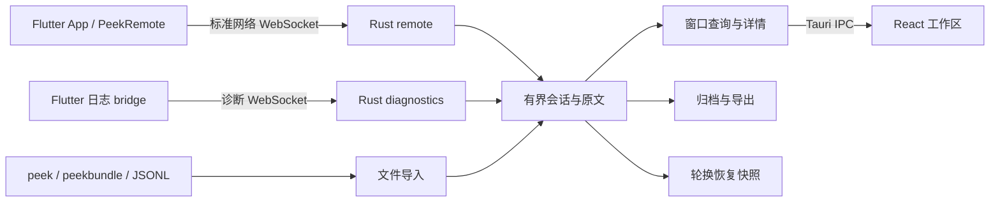

# 架构说明

Peek Desktop 接收 Flutter App 已采集的网络和诊断数据，也能读取离线文件。Rust 管理连接、原文、查询与磁盘操作；React 只请求当前列表窗口和选中详情。

当前功能和待办分别见[项目 README](../README.md)与[待办列表](待办.md)。本页描述已经采用的实现，不列框架候选或尚未实现的交互。

## 数据流

网络与诊断共用一次设备配对，传输分为两路。网络连接使用官方 Peek remote protocol v1；诊断先探测能力，再使用本项目的[诊断协议](诊断协议v1.md)。不支持诊断扩展的客户端仍可同步网络。

## 代码位置

| 路径 | 职责 |
| --- | --- |
| `src-tauri/src/protocol/` | 标准网络、会话文件和诊断事件编解码 |
| `src-tauri/src/remote/` | 监听、配对、mDNS、网络/诊断状态和实时存储 |
| `src-tauri/src/session/`、`query/` | 离线会话、原文预算、索引与窗口查询 |
| `src-tauri/src/body/` | 正文状态、解析和有界预览 |
| `src-tauri/src/storage/` | 会话文件读写 |
| `src-tauri/src/archive.rs`、`export.rs` | 完整归档、JSONL、HAR、文本与 cURL |
| `src-tauri/src/recovery.rs` | 恢复配置、单写入者锁和双份快照 |
| `src-tauri/src/commands/`、`lib.rs` | Tauri 命令、菜单、文件对话框与应用生命周期 |
| `src/features/` | 网络、日志、时间线、连接、详情和文件工具界面 |
| `src/lib/ipc/`、`commands/`、`i18n/` | IPC 类型、操作调度与中英文词条 |
| `sdk/` | 固定提交的独立 Flutter SDK 子模块 |

## 列表与 IPC

Rust 保存会话和原始记录，前端按 revision 查询可见窗口。网络列表通常预读最多 300 行，接口硬上限 500；诊断和时间线每次最多 300 行。详情与正文在选中后加载，避免把全部正文复制到 WebView。

React 使用 TanStack Table / Virtual 渲染可见行，Zustand 保存视图状态。搜索和过滤在 Rust 端执行；旧查询、旧详情和重连前的数据响应会被版本检查丢弃。实时通知经过批处理，列表更新不逐条推送全部原文。

磁盘压缩、校验和正文解析在后台执行。归档和恢复先短暂锁定并捕获快照，再在锁外编解码，最后整组提交，避免多秒磁盘操作阻塞网络接收。

## 正文与 JSON

正文区分未采集、远端待加载、已加载、截断和设备已丢弃。远端正文使用请求 ID 关联，限制在途数量并设置超时；旧连接的响应不能写入新会话。

JSON 分析放在 Worker，树视图按需加载 `vanilla-jsoneditor`，使用 `lossless-json` 保留长整数和高精度小数。组件卸载时销毁编辑器；树、格式化与复制不会覆盖收到的原文。无效 JSON 和重复 key 以原文为准。

文本、Hex 和树视图都有预览限制；保存文件使用 Rust 中保留的原始内容。容量和格式细节见[文件说明](文件与恢复.md#容量)。

## 配对与权限

监听默认关闭，用户选择仅本机或局域网后启动。四位配对码 180 秒有效，成功一次即失效，连续五次错误会轮换。最多配对 4 个设备。

稳定桌面身份和设备 token 摘要存入 macOS Keychain / Windows Credential Manager。写入失败时回滚配对，不改存明文。网络和诊断分别授权；关闭诊断只断开日志通道，忘记设备撤销两路权限。

二维码和 mDNS 提供地址与身份；长期 token 只用于授权握手，不出现在二维码、URL 或日志中。局域网使用明文 WebSocket，适合可信开发网络，尚未提供 TLS 传输。

## 查看与菜单

网络、日志、异常和时间线分别保留过滤及选择状态，共享时间范围。异常指纹用于分组展示，原始事件仍保留。时间线按墙钟时间排序，准确关联依赖同一会话中的显式请求 ID。

工具栏、快捷键和原生菜单共用稳定命令 ID。Rust 菜单事件发回前端调度；右键菜单使用临时原生 ID 映射，替换或卸载时清理。弹出菜单前释放资源表锁，避免 macOS 菜单跟踪期间阻塞 IPC。相关回归见 [P2 记录](P2实施记录.md)。

## 文件和恢复

`.peek` 保留有效网络原文，`.peekbundle` 额外保存诊断、关联和统计。保存采用临时文件、同步和原子替换；归档导入先校验完整内容，再整组加入工作区。

恢复快照默认关闭，每 5 秒按变化保存、正常退出补存。两份槽位轮换，损坏时回退；恢复结果使用离线身份，不恢复监听或实时 ACK。具体步骤见[恢复工作区](文件与恢复.md#恢复工作区)。

## 上游与参考

协议和测试样例固定到 [Peek e26198e](https://github.com/artdima/peek/commit/e26198e7d480138d6afdf5a1815130beb04b88b7)，原生协议实现参考 [Peek Pro 2709bd6](https://github.com/artdima/peek-pro/commit/2709bd61abf8922a29c028696e4eef0b6e44078f)。样例来源以[仓库内说明](../src-tauri/tests/fixtures/upstream/README.md)为准。

文档组织参考 [Talker](https://github.com/Frezyx/talker) 的分包入口和 [Chucker Flutter](https://github.com/syedmurtaza108/chucker-flutter) 的安装、接入示例。使用流程放在指南，协议和历史测试结果单独存放。界面借鉴网络检查工具常见的会话侧栏、请求列表与详情分栏，组件在本项目中实现。
