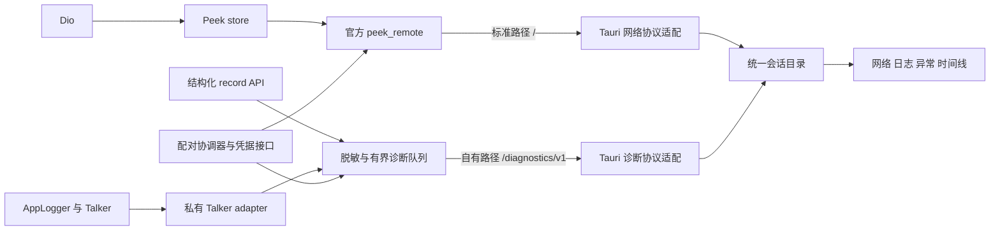

# 普通日志与异常同步方案

日期：2026 年 11 月 13 日，北京时间  
阶段：P1 已实现诊断 SDK 和独立诊断接收；P2 已接入日志/异常筛选、分组、复制导出及关联时间线。以下保留完整设计，实际交付与验收范围见 [P1 实施记录](P1实施记录.md)、[P2 实施记录](P2实施记录.md) 及 [P3 实施记录](P3实施记录.md)。P3 已接入完整归档、历史 JSONL、完整日志导出及双份工作区恢复快照。

Peek Desktop 在网络请求之外增加普通日志和异常预览。推荐开发自有 Flutter package `peek_desktop_bridge`：订阅 Talker 的结构化事件、保留异常堆栈，通过独立的诊断通道发送到自己的 Tauri 客户端。网络请求继续使用现有 `peek_dio + peek_remote`，两个数据源归属同一个 App 运行会话，在桌面提供网络、日志、异常和时间线视图。

第一版采用“两条数据通道，共用一次配对”：保留标准 Peek 连接，增加自有诊断 WebSocket；通过公开的连接与凭据适配接口协调身份。这样可以继续跟进上游 Peek，日志协议和预览能力由本项目独立维护。

## 1 数据来源与边界

Talker 的 `stream` 可以订阅日志、错误与异常。`peek_talker` 默认把它识别的网络日志映射为 Peek 网络记录，不提供本方案需要的通用日志数据模型与桌面日志通道。[Talker 事件流](https://pub.dev/documentation/talker/latest/talker/Talker-class.html)、[Peek Talker 适配器](https://github.com/artdima/peek/blob/main/packages/peek_talker/lib/src/peek_talker_adapter.dart)

| 数据 | 接入方式 | 桌面展示 |
| --- | --- | --- |
| Dio 请求与响应 | 继续 `PeekDioInterceptor → Peek store → PeekRemote` | 网络请求表格与详情 |
| 普通日志 | 自有 Talker adapter 读取 `TalkerData` | 日志列表、级别与分类筛选 |
| Dart/Flutter 异常 | 读取既有异常入口交给 Talker 的事件与完整堆栈 | 异常列表、详情、分组与时间线 |
| 结构化业务事件 | 可选 `bridge.record()`，使用相同诊断模型 | 日志属性树与关联记录 |
| `print`、`debugPrint` | 第一版不自动重定向；需要时单独提供显式适配 | 显示为独立 source，不能假定已覆盖 |
| Swift/Kotlin 原生日志、系统崩溃 | 后续独立采集或文件导入 | 不能通过 Talker 订阅自动得到 |

普通日志有级别、分类、消息和属性；异常有类型、上下文与堆栈。它们采用 `DiagnosticEvent`，保留自己的语义。不给普通日志构造虚假的 HTTP method、URL 或 status，也不通过修改 Peek 网络记录数量实现“日志数量”。

## 2 总体结构



Rust 侧分别管理 `network_entries` 和 `diagnostic_events`，会话目录负责关联设备与 App 运行实例。界面共享选择、时间范围和搜索交互，查询仍按数据类型执行；一个流量高峰不能让日志订阅重复推送所有网络正文。

这里的“私有插件”主要是 Dart/Flutter package。事件模型、Talker 订阅、排队和 WebSocket 可以使用 Dart 实现；凭据存储复用成熟的平台适配，无需为订阅普通日志自行编写 Swift/Kotlin 原生插件。

## 3 标准 Peek 与自有扩展如何并存

标准 Peek 协议面向网络记录；现有 `PeekRemote` 发送其 store 的历史与变化。仅增加一个 Talker listener，不能自动让它发送任意诊断消息。[远程协议](https://github.com/artdima/peek/blob/main/doc/spec/remote-protocol.md)、[PeekRemote 实现](https://github.com/artdima/peek/blob/main/packages/peek_remote/lib/src/client/peek_remote.dart)

| 路径或能力 | 第一版行为 |
| --- | --- |
| `ws://desktop:9741/` | 标准 Peek protocol v1，保留原有网络兼容 |
| `GET http://desktop:9741/diagnostics/v1/capabilities` | 自有服务能力探测，只返回版本、server identity 和支持能力，不返回日志或 token |
| `ws://desktop:9741/diagnostics/v1` | 自有诊断协议，包含单独握手、授权、日志批次与确认 |
| 标准 `.peek` | 保持上游网络文件格式 |
| 自有 `.peekbundle` | 后续保存网络、日志及关联信息的完整会话 |

两个 WebSocket 可以由同一个 Rust listener 按 path 分流，共用端口。自有协议使用独立的 `protocol` 与 `version`，不增加或覆盖标准 Peek 的 `protocolVersion` 含义。

客户端完成标准配对后探测诊断能力。遇到原版 Peek Pro、不支持的版本、超时或不存在的路径，就停止本轮诊断连接，继续保留网络能力；不反复发送扩展帧、不循环弹配对提示。原版 Peek Pro 继续只显示其支持的网络内容。

| App 侧 | 桌面端 | 结果 |
| --- | --- | --- |
| 只有官方 `peek_remote` | Peek Desktop | 网络可用，日志与异常视图提示尚未接入诊断 SDK |
| 官方 `peek_remote` + 私有 bridge | Peek Desktop | 网络、日志和异常可关联预览 |
| 官方 `peek_remote` + 私有 bridge | 原版 Peek Pro | 网络按原协议工作，私有诊断通道保持未启用 |

第一版不 fork Peek/peek_remote。以后若单连接复用确有收益，再在自有协议新版本中合并传输；届时仍保留标准兼容入口，不要求外部 App 跟随自有扩展升级。

## 4 一次配对与精确会话关联

### 共用配对记录

接入基线为 ePay 当前使用的 `peek_remote 2.1.1` 与 `talker 5.1.20`；后续升级重新验证公开接口及事件行为。

诊断 SDK 提供 `DesktopConnectionCoordinator`，通过 `attachPeekRemote(remote)` 绑定已有的官方客户端。当前 `peek_remote` 的公开 API 已提供 `stateChanges`、`sessionId`、`endpoint`、`deviceToken` 和 `serverId`。协调器先订阅状态并检查初始状态，在标准连接完成授权后读取这些公开信息，启动对应的诊断通道；不再次消耗一次性的配对码。[公开客户端 API](https://github.com/artdima/peek/blob/main/packages/peek_remote/lib/src/client/peek_remote.dart)

第一版复用官方客户端已有的配对管理，诊断模块不再复制持久保存一份 token。不读取上游私有字段、不直接依赖 `shared_preferences` 内部 key，也不扫描设备上的其他应用凭据。后续需要统一替换凭据存储时，再通过公开的 `PeekRemoteMemory` 注入适配器，并为现有配对提供经过验证的迁移。[公开凭据接口](https://github.com/artdima/peek/blob/main/packages/peek_remote/lib/src/client/peek_remote_memory.dart)

Tauri 配对记录分别保存网络与诊断能力授权。诊断握手验证 device token、server identity 与对应权限；只撤销诊断时网络连接可以继续，忘记设备时两个通道均关闭。token 放在握手消息中，不放入 URL 或调试日志。源码分发方式与设备连接授权各自独立，开源后仍需完成设备配对和能力授权。

用户停止、忘记或切换标准连接目标时，协调器停止旧诊断连接并清理对应的在途任务；等待标准连接重新授权后再恢复。初始化时要处理“remote 已经连接”的情况，不能只等待下一次状态变化。

### 关联同一次 App 运行

SDK 为每次 App 启动生成 `runId`，跨重连保持不变。网络协议的 `sessionId` 直接读取官方客户端公开的 `remote.sessionId`，不能直接假定与 SDK 的 runId 相等。

使用公开 getter 即可取得准确关联，无需包装传输或截取握手报文。SDK 固定依赖版本，并用兼容测试验证状态、sessionId 和配对凭据在首次连接、重连、拒绝与忘记设备时的行为。[PeekRemote 会话与连接状态](https://github.com/artdima/peek/blob/main/packages/peek_remote/lib/src/client/peek_remote.dart)

诊断握手携带该 `networkSessionId`。服务端只有在设备身份、所属网络会话和 runId 对应关系验证后才合并展示。若获取不到准确关联，先显示为独立诊断会话；不按 App 名称、IP 或相近时间强行合并。

登录账号切换等敏感上下文变化通过 App 的显式 `resetContext()` 处理，清理待发送历史并更新 context generation，避免同一进程中的旧账号日志被误带到新上下文。

## 5 SDK package 的边界与接入

SDK 已迁移到 MIT 开源仓库 [peek-flutter-sdk](https://github.com/lx8s8/peek-flutter-sdk)，统一维护连接与日志两个 package。桌面通过 `sdk` 子模块固定版本进行跨语言验证；首次 clone 后执行 `git submodule update --init --recursive`。App 使用同一 Git tag/commit 加包目录引用。

```text
sdk/packages/peek_desktop_bridge/            # 诊断 SDK 子模块，实际文件以仓库为准
├── pubspec.yaml
├── lib/
│   ├── peek_desktop_bridge.dart            # 公共配置与生命周期
│   ├── model/                             # 诊断事件与协议 DTO
│   ├── adapters/talker_adapter.dart        # TalkerData 到诊断事件
│   ├── adapters/peek_remote_adapter.dart   # 标准配对与会话协调
│   ├── transport/                         # 能力探测、鉴权、确认与重连
│   ├── buffering/                         # 字节容量、优先级与历史回放
│   └── redaction/                         # 日志字段、消息与堆栈脱敏
├── test/fixtures/
└── example/                               # 最小演示 App
```

package 的事件模型不依赖 ePay 页面、Provider、MMKV key 或 `AppLogger` 类型。ePay 特有的堆栈与 tag 映射通过调用方传入的 converter 完成，之后其他 Flutter App 也可以复用。

下例保留设计时的调用顺序；**当前可调用 API 与完整接入示例以 [SDK README](../sdk/packages/peek_desktop_bridge/README.md) 为准**：

```dart
if (NetworkInspector.enabled) {
  final remote = NetworkInspector.peek.attach(
    PeekRemote(NetworkInspector.peek),
  );
  final bridge = DesktopDiagnosticsBridge(
    redactor: appDiagnosticRedactor,
  );

  bridge.attachTalker(
    AppLogger.log,
    converter: mapEpayDiagnostic,
  );

  bridge.attachPeekRemote(remote);
  bridge.start();
  remote.start();
}
```

初始化在 Flutter 绑定、AppLogger 与品牌配置完成后进行。同一 Talker 实例重复 attach 不新增订阅；dispose 取消 listener、计时器、连接和待处理任务。桥接失败只影响桌面调试，不能阻断业务日志、文件日志或业务请求。

示意接线用于调整现有 `NetworkInspector.initializeRemote()` 的单个初始化入口；不在已经启动的 `PeekRemote` 旁再创建第二个网络客户端。`PeekDioInterceptor` 也保持单份，普通日志 adapter 不再采集一次 Dio 请求。

开发中可以使用 `path` 依赖，正式消费使用公开 HTTPS Git 的 tag 或固定 commit。package 声明 `publish_to: none`，避免误发公共包仓库；这项设置不代替 Git 仓库的访问权限。[Dart 依赖来源](https://dart.dev/tools/pub/dependencies#git-packages)、[publish_to](https://dart.dev/tools/pub/pubspec#publish_to)

## 6 ePay 现有日志链的接入细节

以下接入点来自当前仓库的 `logger.dart`、`error_log_handler.dart` 与 `local_log_record.dart`，实现时仍以实际代码为准。

| 当前入口 | 已有行为 | 私有 bridge 的处理 |
| --- | --- | --- |
| `AppLogger.i()` | 调用 `Talker.info()` | 从 Talker stream 接收，不依赖控制台打印开关 |
| `AppLogger.w()` | 经过限流后交给 Talker，同时写本地 WARN | 从 Talker stream 获取已接纳事件；不再次从文件 tail 同一条实时记录 |
| `reportError()` 与 `_recordError()` | 多个异常入口统一去重，交给 Talker 并保存本地 ERROR | 在既有去重之后订阅，避免安装第二套全局异常处理器重复上报 |
| `OriginalErrorStack` | 为简化内置日志卡片，把原始堆栈放在 `originalStackTrace` | ePay converter 优先读取原始堆栈，再回退到普通 `stackTrace` |
| `LocalLogStore` | 持久保存受容量限制的 WARN/ERROR | 单独作为“导入历史日志”来源，不假定有完整 INFO 历史 |

Talker 控制台输出与事件流是不同出口。普通级别日志即使不打印到控制台，仍可通过已启用且通过筛选的 Talker stream 进入 bridge。[Talker 文档](https://pub.dev/documentation/talker/latest/talker/Talker-class.html)

ePay 的 `AppLogger.w(info, tag: ...)` 当前给 Talker 的是 `warning(info)`，tag 仅进入本地记录；不能声称单凭 Talker stream 就能完整恢复这个结构化 tag。后续在 AppLogger 的结构化日志对象中携带 tag，或为该入口提供显式 converter/hook；选择一个规范化来源，避免 stream 与 hook 同时生成两条事件。

ePay 已覆盖 Flutter framework、PlatformDispatcher、Zone 与部分 Isolate 错误入口。bridge 默认复用这些入口的输出，不覆盖 `FlutterError.onError` 或已有 Firebase 上报。其他 App 如需自动异常捕获，则提供独立 opt-in 集成，正确串接原处理器。[Flutter 异常处理](https://docs.flutter.dev/testing/errors)

被 App 既有限流器抑制的事件不会出现在 Talker stream；以后需要显示“重复次数”时，应从限流器提供汇总信息，不能在桌面伪造精确次数。原生崩溃、OOM 和进程强杀也不能保证来得及通过 WebSocket 发出，仍需保留本地文件与现有崩溃报告。

## 7 诊断数据模型

`DiagnosticEvent` 以日志与异常为核心，不复制 HTTP 模型。所有可增长字段与嵌套结构都设容量和深度限制。

| 字段 | 含义 |
| --- | --- |
| `eventId` | 稳定事件 ID，回放和重连时保持不变 |
| `runId` / `emitterId` | App 运行实例与发送源，后者可区分 isolate |
| `sequence` | 发送源内递增序号，在线路上使用十进制字符串，避免 JS 大整数精度丢失 |
| `occurredAt` | App 记录事件的 UTC 时间 |
| `monotonicMicros` | 同一运行源中的相对单调时间，使用十进制字符串；不与其他设备直接比较 |
| `kind` / `level` | `log` 或 `exception`；verbose、debug、info、warning、error、critical |
| `source` / `tag` | 事件来源与可选业务分类 |
| `message` / `attributes` | 可读消息与经过规范化、脱敏的结构化属性 |
| `exception` | 可选异常类型、错误信息、原始堆栈文本与堆栈格式 |
| `relatedNetworkEntryId` / `traceId` | 明确传入的关联信息，缺失时不推断成精确因果关系 |
| `truncated` / `truncatedFields` | 哪些字段因上限被裁剪，显示时明确标记 |

示例仅包含合成数据：

```json
{
  "eventId": "run-demo/main/42",
  "runId": "run-demo",
  "emitterId": "main",
  "sequence": "42",
  "occurredAt": "2026-11-13T03:00:00.000Z",
  "monotonicMicros": "2500000",
  "kind": "exception",
  "level": "error",
  "source": "app_logger",
  "tag": "contact",
  "message": "联系人数据解析失败",
  "attributes": {"operation": "load_contacts"},
  "exception": {
    "type": "FormatException",
    "message": "Invalid synthetic payload",
    "stackTrace": "#0 parseSyntheticContact (...)\n#1 loadSyntheticContacts (...)",
    "stackFormat": "dart"
  },
  "truncated": false
}
```

服务端另外记录 `receivedAt`。同设备同源内使用 sequence 排序；跨来源或跨设备的时间线只表示可解释的时间顺序，不声称设备时钟完全同步。关联网络请求优先采用显式 ID/traceId；仅按时间邻近找到的请求必须显示为“附近请求”。

AOT/混淆堆栈原文与格式必须保留；运行会话元数据可附带 App version、build number、platform、flavor、符号 build identity 等白名单信息。符号还原属于单独能力，先支持原文查看、复制与导出，再接入正确构建的符号文件，不能把无法解析的地址显示为已还原代码位置。

## 8 自有诊断协议与可靠性

自有握手使用 `protocol: "peek-desktop-diagnostics"`、`version: 1`，携带 server identity、device token、runId、准确的 networkSessionId（可空）与可恢复序号范围。服务端完成授权后才接收日志数据。诊断版本与标准 Peek 版本独立协商。

| 消息 | 用途 |
| --- | --- |
| `diagnostics.hello` / `welcome` / `denied` | 鉴权、协商能力、返回每个 emitter 已接纳的序号 |
| `diagnostics.batch` | 按发送源顺序批量传递事件 |
| `diagnostics.ack` | 累计确认已处理的序号，用于限流、释放发送缓冲与重连恢复 |
| `diagnostics.gap` | 明确说明某段序号已丢失或被淘汰及原因 |
| `diagnostics.ping` / `pong` | 存活检测 |

第一版交付语义是：**仍在有界缓冲中的事件可以重试，服务端按 eventId 去重；已经被淘汰的事件明确报告缺口**。不承诺无限期离线保存或端到端 exactly-once。

ACK 表示 Rust 会话层已接纳事件，不能把它当作写入磁盘成功。未来如果需要持久可靠投递，增加单独的持久化模式与确认契约。累计确认只能跨过已接纳或明确 gap 的序号，不能因为收到较新的事件就掩盖中间丢失。

### 初始容量与调度

以下参数用于 P0 压测后调整：

- App 内历史与待发送队列同时受 2,000 条和 4 MiB 限制，任一达到即触发保留策略
- 单事件序列化后初始上限 128 KiB，超限时按字段裁剪并带标记，保持合法 UTF-8
- 每 50 ms 或累计 64 条形成一个批次，同时限制批次字节数与未确认的在途字节数
- 非关键日志过载时优先淘汰低级别；异常和 WARN/ERROR 有保留预算，但同样受硬上限约束
- App、传输、Rust 接收与 UI 展示分别维护接收数、淘汰数、重试数和去重数
- 网络正文与普通日志使用独立队列和预算，正文高峰不会无限挤占异常预览

先订阅直播事件再读取已有 Talker 历史，通过事件对象/稳定事件 ID 建立边界并合并，避免“读取历史后才订阅”导致漏日志。历史回放默认只包含内存中已有记录，桌面显示回放范围与容量限制。

传输自身出错时使用独立的低频本地诊断回调，不把错误重新送回同一个 Talker stream 形成递归。对象转字符串或属性序列化失败也只产生有界替代说明，不把异常抛回业务调用方。

## 9 桌面端的预览方式

会话顶部增加“网络 / 日志 / 异常 / 时间线”，共享设备和时间范围；各视图保留自己的过滤条件和选择。左侧显示设备是否具备诊断能力，不能把未接入 SDK 的空日志显示成采集正常。

| 视图 | 内容与操作 |
| --- | --- |
| 日志 | 时间、级别、分类、来源、消息摘要；支持全文搜索、级别/tag/isolate 过滤、跟随最新、暂停自动滚动 |
| 异常 | 类型、摘要、首次/最近出现时间与实际已接收次数；指纹分组只影响展示，保留每条原始事件 |
| 详情 | 完整消息、属性 JSON 树、原始堆栈、元数据、截断状态；复制消息、复制堆栈、导出所选 |
| 时间线 | 并排查看网络与诊断事件，标识近似时间与精确关联；点击跳转对应详情 |

列表沿用虚拟化、后端搜索、查询 revision、稳定行 ID 与批量 Channel。消息与堆栈默认只读文本；结构化 attributes 复用现有 JSON 查看器。异常详情懒加载，不为每一行预先挂载一个编辑器。

### 会话保存与历史导入

完整会话采用自有 `.peekbundle` ZIP 容器，现已包含 `manifest.json`、`network/0.peek`、`diagnostics/0.jsonl` 等成员和关联/保留计数。manifest 包含容器、网络与诊断版本，以及成员 SHA-256/字节数/条数；导入时完整校验版本、关联及展开容量，失败不添加部分会话。恢复快照使用同一容器的两个固定槽位，作为独立离线副本导入。

导出标准 `.peek` 时只保存网络记录，界面明确该格式不包含普通日志与异常。ePay 的本地 WARN/ERROR 文件可以通过单独导入适配器转换为诊断事件；其稳定来源 ID 与实时 eventId 不同，未经可靠关联的历史文件保持独立来源，不进行猜测去重。

## 10 开关 脱敏与保留

SDK 初始化必须位于编译期调试能力开关之后。ePay 沿用当前 `NetworkInspector.enabled`：prod 的 Release/Profile 不创建桥接实例、不订阅 Talker、不分配诊断缓冲、不读取配对、不探测桌面。历史配对或桌面下发设置都不能打开正式包的诊断能力。

需要分别处理网络数据与诊断数据的脱敏。现有 Peek redaction 只保护进入 Peek 的网络记录；普通日志的 message、attributes、异常信息和堆栈必须经过自己的 redactor，再进入 SDK 历史、发送队列或会话文件。

结构化属性使用允许的业务字段与递归敏感字段规则；自由文本采用 App 提供的清理规则与容量限制。不能保证靠关键词替换识别任意文本中的所有敏感数据。登录/支付信息、验证码、密钥与完整环境配置不应作为调试属性直接采集。

SDK 通过公开 Git 仓库按 MIT 许可证分发；设备授权、编译开关和数据处理仍由 SDK 与桌面分别执行。网络传输遵循所协商的协议，源码公开不改变设备配对与链路安全边界。

## 11 实施与验收

| 阶段 | 交付 | 验收重点 |
| --- | --- | --- |
| D0 契约验证 | DiagnosticEvent、能力探测、双连接配对与会话关联原型、双方 fixture | 官方 Peek 继续连接；原版桌面自动降级；不依赖上游私有字段 |
| D1 诊断 SDK 与 Rust 接收 | Talker adapter、ePay converter、队列、诊断握手、查询存储 | INFO/WARN/异常与原始堆栈在桌面完整预览；重复初始化不重复采集 |
| D2 日常预览 | 过滤、异常分组、属性 JSON、复制与网络关联 | 准确标识截断、缺口、历史范围与近似关联；两端键盘操作可用 |
| D3 可靠性与导出 | ACK/恢复、容量压力、bundle、历史文件导入 | 断线不重复显示；容量溢出有说明；保存后可离线预览 |

与主方案的 P0–P3 并行纳入：P0 先验证公开适配接口和数据契约；P1 建立配对与两路数据接收；P2 完成日志/异常视图；P3 完成恢复、缓存与完整会话文件。

专项验证包括：普通日志、Error/Exception、空堆栈与 `OriginalErrorStack`；tag 缺失与显式传递；历史回放和直播边界；重复订阅与错误递归；重连、撤销、上下文切换与准确会话绑定；长整数和超大属性；原版客户端互操作；以及 prod Release/Profile 开关关闭后的零初始化行为。

仓库已实现 Flutter package、桌面监听及 P2 查看功能；SDK 与连接包已按 MIT 许可证独立开源，宿主已接入扫码回调、历史电脑和 Talker 日志同步。完整会话归档、磁盘工作区恢复与标准诊断 JSONL 历史导入已接入；ePay 私有历史格式适配器、逐事件持久 ACK、Windows/物理移动设备及完整性能矩阵仍需独立推进。
